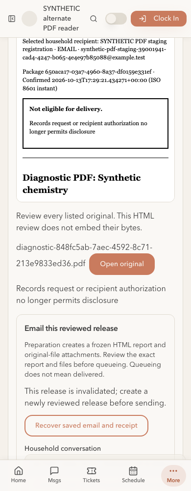

# Diagnostic PDFs in numbered records requests — approved rollout

Dave approved #245; the tested head `11f642a56c3244c95dfaf13657b99a05b4ab84ed` merged as `20b035f1e93ac4629b4051dedbff736952cc267f` on October13. Staging and primary now have179 migrations, zero pending, and all eight affected Edge Functions deployed. Production is READY at that merge commit. Permanent clinical, recipient-disclosure, diagnostic worker/runtime and staff-download policies remain empty/off. Susan's acceptance and all45 launch requirements remain open.

See the [machine receipt](2026-10-13-diagnostic-pdf-record-packages-rollout.json), [approved-head CI receipt](2026-10-13-diagnostic-pdf-record-packages-ci.json), [implementation](2026-10-13-diagnostic-pdf-record-packages-implementation.md) and [plan](../../plans/2026-10-12-diagnostic-pdf-release/plan.md).

## Installation and deployed acceptance

Migration `20261013003556_diagnostic_pdf_record_packages.sql` SHA256 `d2724dd9d8be1d6b6f96eabd88025ac0548d7a3b1f602a77a272c69076510ce7` was the only pending migration on each178 baseline. Protected prior function/ACL/constraint/history backups preceded installation. Vault, seeds and roles were skipped. Each backend passed38 fresh-UUID rollback assertions, seven canonical function-body/ACL checks,16 private RLS ledger checks and the correction-trigger check. Before/after clinical, request, package, capture, Storage metadata and outbox content digests matched. Marker bytes in this SQL proof establish contracts only; they are not native PDF admission proof.

Staging independently passed193 genuine checks: one admitted native PDF, two validator runs,32,745 bytes, exact private Storage readback,63 current and63 explicit historical numbered-package checks,46 deployed staff-download/desktop/mobile checks, and cleanup. The artifact SHA256 is `07d8d0dace405824874dba07b3619d0243ff3f85be82ba6163e84a730f16b2ad`. The approved native image remains `lrv-diagnostic-pdf@sha256:e74492886124237c6fdeb1b887709f9dd08778f0713ef7998dee9f1a1d1520c0`.

Actual deployed email and protected-link preparation read and freeze the unchanged PDF. Deployed capability retrieval returns the same bytes. Altered bytes fail the SQL verifier. Client cancellation and authorized-clinic revocation block fresh capture contexts; repeated confirmation recovers the immutable receipt. Current and historical modes remain explicit after a genuine diagnostic correction. The current selection does not fall back to older bytes. The PDF's two embedded panels are disclosed and require expansion review. Desktop/mobile package review and original downloads preserve44px targets and produce zero page errors. Hosted revocation checks are sequential; observed contention remains the separately recorded exact-head local/CI proof.

## Function deployment repair

The shared diagnostic validator imports bare `zod`. Four consumers already had function-local Deno maps; four did not: `capture-conversation-email`, `dispatch-outbox`, `prepare-payment-delivery` and `prepare-release-email`. The root Deno/Node environment had masked this difference in existing CI. Two staging deployment attempts rejected those four bundles; the four already configured consumers advanced versions. No provider sends occurred. Deploying all eight with the existing explicit `npm:zod@3.25.76` map succeeded. Primary's single mapped deployment succeeded.

The complete affected set is the four names above plus `prepare-document-link`, `recover-document-link`, `retrieve-document-link` and `prepare-invoice-email`. Protected old source backups are retained locally. Every final function is ACTIVE; JWT settings match its prior value and committed config. Unaffected function versions remain unchanged. No pruning or permanent secret changes occurred.

The follow-up adds the four missing configs/locks and a CI check that discovers every consumer of `record-release-diagnostics.ts`, copies only `_shared` and that function, then checks and bundles with its own frozen dependency lock. All eight isolated builds pass. Frontend unit tests remain1370/1370; typecheck and lint pass with the existing four refresh warnings. No new schema migration or generated Supabase types are included.

## Cleanup and operational state

Staging initially lacked sender/link runtime configuration. The bounded test used a synthetic sender and an independently generated temporary HMAC version, with no overwritten settings or changed provider credentials/delivery mode. All five added settings were removed. Test-only clinical/disclosure/worker/runtime/staff-download policies were removed; synthetic accounts were banned/offboarded, refresh tokens revoked, sessions retired, the patient archived, and the exact physical PDF object deleted. Immutable synthetic capture/request/audit history remains. Failed fixture attempts were also retired; shared-phone consent validation was preserved by choosing a unique reserved synthetic number for the successful run. No provider queue was created.

All12 owned VMs created after this merge—including failed fixture attempts—are independently verified stopped, nonpersistent and deny-all, with no snapshots. [VM audit](2026-10-13-diagnostic-pdf-packages-rollout-vm-audit.json). This is not a claim that provider Storage object bodies have a commissioned backup.

Primary retains its baseline three outbox entries and zero payment-provider profiles. Staging retains zero outbox entries and its one existing payment profile. Security advisors remain465 WARN/zero ERROR on each backend, with zero added or removed findings compared with178. The intentional authenticated staff metadata projection remains the previously reviewed advisory.

The production deployment is `dpl_7aWMceh97ivaZV959kjVzeJbWKsU`; `/hub/login` responds200 and serves `/assets/index-2N2CWv3r.js` using primary only, with zero page errors and anonymous diagnostic-download rejection401. No primary synthetic staff session or persistent clinical fixture was created.

Next: approve the function-config/CI repair PR, then continue the appointment-types, next-visit and daily-room-task batch. Engineering installation does not complete Susan's rendered clinical/workflow acceptance, remaining vendor proofs, object-body backup commissioning or the launch checklist.
